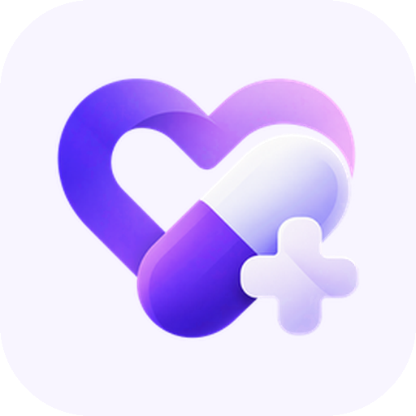

  

<h1 align="center">Health per Android</h1>

Terapie, visite e documenti sanitari, solo sul tuo dispositivo. App nativa della famiglia Dueffe.

---

App nativa Kotlin + Jetpack Compose. I dati sanitari restano nel dispositivo; il backup JSON può essere esportato/importato dalle Impostazioni. Gli allegati vengono copiati nello spazio privato dell'app e non sono inclusi nel backup JSON.

I moduli per farmaci, visite e documenti guidano l'inserimento in passaggi. Per i farmaci si scelgono frequenza, giorni e orari con selettori; la programmazione delle dosi e dei promemoria segue queste scelte. Le terapie al bisogno non generano avvisi automatici e le assunzioni si possono segnare dalla lista Terapie.

## Avvio e distribuzione

- `run-pixel.command` avvia il primo AVD Pixel disponibile, compila e installa la build debug. È eseguibile con doppio clic dal Finder e chiude la finestra Terminal al completamento riuscito.
- `release-apk.command` incrementa `VERSION_CODE` e la patch di `VERSION_NAME`, compila un APK firmato e pubblica soltanto il file APK come release `health-vX.Y.Z` in `carellice/android-app-releases` (modificabile con `RELEASE_REPO=owner/repo`). Dopo la pubblicazione elimina solo le release precedenti con tag `health-v*` e solo i relativi tag, lasciando intatte quelle delle altre app. Salva la nuova versione nel progetto solo al completamento del rilascio. È eseguibile con doppio clic dal Finder e chiude la finestra Terminal al completamento riuscito.

Requisiti: Android Studio con SDK 36, JDK 17 o più recente compatibile con Gradle, `gh auth login` con accesso alla repository. Per la firma lo script crea al primo avvio `.secrets/health-release.jks`; conservarne una copia sicura per aggiornare l'app senza reinstallarla.

Le notifiche sono programmate come allarmi inesatti per rispettare le restrizioni Android e possono arrivare con qualche minuto di ritardo. Android 13+ richiede il consenso alle notifiche.

## Dati della precedente PWA

Prima di smettere di usare la PWA già installata nel browser, esporta da essa un backup JSON e importalo in Impostazioni nell'app Android. I backup PWA esportano un profilo per volta e non includono gli allegati né lo storico delle dosi; la nuova app non può leggere direttamente il `localStorage` del browser. I nuovi backup Android includono anche lo storico delle dosi.
